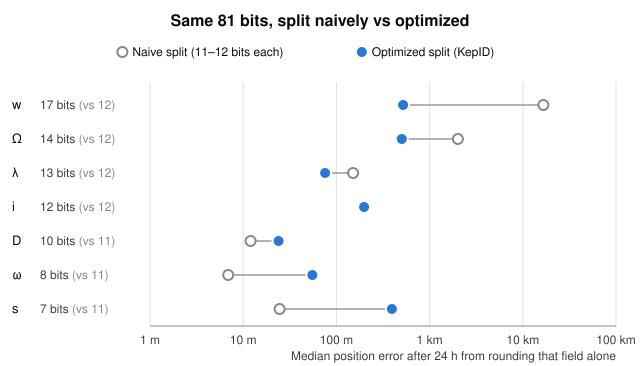
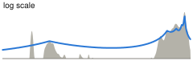
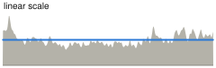
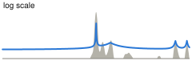
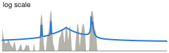
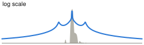
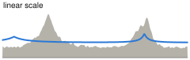
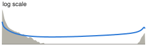

# KepID - Satellite orbits packed into UUIDv7

Take a satellite's Keplerian elements, the six numbers named after Johannes Kepler that a TLE or an OMM carries (strictly speaking, SGP4 mean elements), round each one to fit, and you get a single 128-bit value that is also a valid UUIDv7.

For example, this TLE of the ISS, from 1 November 2026:

```
1 25544U 98067A   26305.20860139  .00006903  00000+0  13267-3 0  9994
2 25544  51.6332 342.0408 0007056 334.5041  25.5599 15.49138562592994
```

becomes this KepID:

```
01a1957a-ebef-73ab-bccf-878de5f3a90d
```

Sixteen bytes instead of 140. It sorts by time, it fits in any UUID column, and it decodes back into an orbit you can propagate.

---

## Why?

Orbital data is everywhere, but it travels in formats designed decades apart from the systems that store it today:

- **TLE**: 140 bytes of fixed-column text, a two-digit year, and nothing a database can sort or index by time.
- **OMM**: the modern, structured alternative, but a single element set easily takes a few hundred bytes of JSON or XML.

That is fine when you are handling a few satellites. It gets wasteful when you are handling *all* of them, or all of them *over time*.

And here is the thing: a lot of applications don't need the full precision. A globe showing every satellite in orbit doesn't care about a few hundred metres; at that zoom, everything is moving way faster than the error is visible. An archive recording which orbit a past computation used doesn't need the original text, just the orbit.

So, what if an orbit could fit in a UUID?

### Use cases

KepID is built for three situations, basically:

- **A lot in space.** Bulk transfer and visualization: a catalog of 30,000 orbits takes about 0.5 MB as KepIDs, against about 4 MB as TLEs and over 12 MB as OMM JSON.
- **A lot in time.** Archives: the orbit behind every pass plan, observation or decision, in 16 bytes instead of hundreds.
- **Plays well with databases.** A KepID is a native UUID: a time range is a key range, and with a compound index like `(object, kepid)`, an object's whole orbit history lives inside the index, ready for index-only scans.

Plus a few bonuses:

- **The whole UUID ecosystem, for free.** Every language and every database already knows how to parse, store, compare and index a UUID; no new library needed just to move KepIDs around.
- **Time extraction with the usual functions.** Any tool that reads a UUIDv7 timestamp gives you the epoch, to within half a second (the last few milliseconds of that timestamp actually hold ω).
- **Cache and deduplication keys.** The same element set always gives the same KepID.
- **Traceability.** One field in a log says which orbit was used.
- **Links and small payloads.** The 36-character text fits a URL or a QR code, and it can get even shorter with [Uuid25](https://github.com/uuid25) (25 characters) or [shortuuid](https://github.com/skorokithakis/shortuuid) (22).

### What's the catch?

**Important:** KepID is lossy and not unique, by design!

- **Lossy:** every element is rounded to a code. For the busy 400–600 km shell, the extra error is a median of about **0.6 km after 24 hours**. For comparison, SGP4 itself is commonly quoted at about 1 km at the epoch, growing 1–3 km a day, so KepID's share is small once you look past the epoch. Higher orbits get coarser steps.
- **Not unique:** a KepID describes an orbit, not an object. It carries no catalog number, and two element sets that round alike get the same KepID.
- **Not a UUIDv7 "in spirit":** it has the right version and variant bits, so all the UUID tooling works, but nothing in it is random, and its timestamp is the element set's epoch, not a creation time. Never use it where a UUIDv7's uniqueness or creation time matters.
- **Limits:** orbits with a perigee below 250 km can't be encoded, and neither can epochs before 1970.

### Should I use it?

- If you need **precision** (conjunction assessment, orbit determination, manoeuvre planning): no, keep the full element set.
- If you need to **identify an object**: no, that's what catalog numbers are for.
- If you need **many orbits, compact, sortable and database-friendly**, and a few hundred metres to a few kilometres don't matter to you: yes, this is exactly what KepID is for!

---

## How it works

This is the abridged version; the full rules are in the [spec](docs/spec.md), and the reasoning behind every number is in the [rationale](docs/rationale.md).

### Layout

```
 0                   1                   2                   3
 0 1 2 3 4 5 6 7 8 9 0 1 2 3 4 5 6 7 8 9 0 1 2 3 4 5 6 7 8 9 0 1
+-+-+-+-+-+-+-+-+-+-+-+-+-+-+-+-+-+-+-+-+-+-+-+-+-+-+-+-+-+-+-+-+
|                   epoch, 256 ms ticks [39:8]                  |
+-+-+-+-+-+-+-+-+-+-+-+-+-+-+-+-+-+-+-+-+-+-+-+-+-+-+-+-+-+-+-+-+
|  epoch [7:0]  |   ω (8 bits)  |  ver  |        i (12 bits)    |
+-+-+-+-+-+-+-+-+-+-+-+-+-+-+-+-+-+-+-+-+-+-+-+-+-+-+-+-+-+-+-+-+
|var|        Ω (14 bits)        |    D (10 bits)    |P| λ, 13 → |
+-+-+-+-+-+-+-+-+-+-+-+-+-+-+-+-+-+-+-+-+-+-+-+-+-+-+-+-+-+-+-+-+
|   λ (cont.)   |           w (17 bits)           | s (7 bits)  |
+-+-+-+-+-+-+-+-+-+-+-+-+-+-+-+-+-+-+-+-+-+-+-+-+-+-+-+-+-+-+-+-+
```

| Field | Bits | What it holds |
|---|---|---|
| epoch | 40 | the element set's epoch, in 256 ms ticks since 1970 |
| ω | 8 | argument of perigee |
| ver | 4 | `0111`, UUID version 7 |
| i | 12 | inclination |
| var | 2 | `10`, the RFC 9562 variant |
| Ω | 14 | right ascension of the ascending node |
| D | 10 | drag: B* scaled by how much it moves the satellite |
| P | 1 | profile bit, `0` for profile 0 |
| λ | 13 | mean argument of latitude, ω + M |
| w | 17 | mean motion, coded as w = R_floor / a |
| s | 7 | eccentricity, coded as s = e / (1 − w) |

Notice that the epoch sits exactly where a UUIDv7 keeps its timestamp: that's what makes KepIDs sort by time. And the hex characters line up with the fields almost one-to-one:

```
TTTTTTTT-TTOO-VIII-*AAA-DD*LLLNNNN*E
```

### The technique

1. **Better variables.** Some raw elements waste codes, so KepID stores a close relative instead. On near-circular orbits, the argument of perigee and the mean anomaly are each fuzzy, but their sum, where the satellite is, isn't. The same drag term matters a lot in low orbit and barely at all high up, so KepID stores its actual effect. And eccentricity is stored relative to the room left above the 250 km floor, so an orbit that dives below it can't be written down: **every** UUID with the right marker bits decodes to a valid orbit.
2. **Bits where they matter.** The 81 bits left after the epoch and the markers are shared among seven fields: the more a field varies across real satellites, and the more its rounding moves the satellite, the more bits it gets. Mean motion gets 17; eccentricity gets 7.
3. **Curves instead of a uniform grid.** Each field is quantized through a curve fitted to a real catalog of 28,443 element sets: codes are dense where satellites actually are (like the 400–600 km shell, the sun-synchronous inclinations, or the epoch right after the ascending node) and sparse elsewhere, but never absent. Think μ-law audio companding, but for orbits.
4. **Bit-exact everywhere.** The curves have closed-form inverses and use only basic IEEE 754 operations (no trigonometry, no library cube root), so the same element set gives the same KepID in any language, on any platform.

Here is step 2 in pictures. Each row is the error a field adds on its own after 24 hours: split the bits equally and mean motion alone throws the satellite about 17 km off, while ω and s get precision nobody needs. Move the bits to where they hurt, and every field lands between tens of metres and half a kilometre:



(Disclosure: the naive split is a rough estimate, the current curves scaled by the bit difference rather than re-fitted, but no re-fit closes a 30-fold gap.)

And here is step 3. The gray area is where real satellites are, and the blue line is where each field puts its codes (click a chart for the full version, with axes and errors):

| Field | How the real values spread | Histogram and curve |
|---|---|---|
| w | Mostly LEO, peaking in the 400–600 km shell, plus small groups at the navigation constellations and the geostationary belt. | [](assets/histogram_fitting_mean_motion.svg) |
| Ω | Spread evenly around the equator, since Earth's oblateness keeps every node turning. Nothing to exploit here, so this one is plain uniform. | [](assets/histogram_fitting_raan.svg) |
| λ | One huge spike right after the ascending node, because that's where element sets are customarily published (59 % within 1° past it). | [](assets/histogram_fitting_lambda.svg) |
| i | A few sharp spikes: the big constellations at 43° and 53°, sun-synchronous at 97–98°, the ISS at 51.6°. Almost nothing above 105°. | [](assets/histogram_fitting_inclination.svg) |
| D | Almost all near zero (85 % in the central bin), mostly positive, with a long thin tail. | [](assets/histogram_fitting_drag.svg) |
| ω | Two broad humps, near 90° and 270°, and flat elsewhere. Near-circular orbits barely feel ω, so the curve stays almost flat and only boosts the eccentric hump. | [](assets/histogram_fitting_arg_perigee.svg) |
| s | Piled up near 0 (near-circular orbits), fading out, with a small rise near 1 from transfer orbits skimming the perigee floor. | [](assets/histogram_fitting_eccentricity.svg) |

Notice that the curves never drop to zero: an orbit nobody flies today still gets codes, just coarser ones.

Pro tip: if you remember only one thing, remember this: a KepID is a *rounded* orbit with a *real* timestamp, wrapped in a *standard* envelope.

---

## Library

### Install

The library is a Rust crate with no dependencies:

```bash
cargo add kepid
```

For OMM support (a serde struct you can read and write with serde_json or any other serde format), turn on the `omm` feature:

```bash
cargo add kepid --features omm
```

Pro tip: if you read OMM JSON with serde_json, also turn on its `float_roundtrip` feature. Without it, a number can be parsed one bit off, and that's sometimes enough to change a KepID.

### Usage

Turning the ISS TLE from the top of this page into a KepID, and back:

```rust
fn main() -> Result<(), kepid::TleError> {
    let line1 = "1 25544U 98067A   26305.20860139  .00006903  00000+0  13267-3 0  9994";
    let line2 = "2 25544  51.6332 342.0408 0007056 334.5041  25.5599 15.49138562592994";

    // TLE to KepID:
    let id = kepid::from_tle(line1, line2)?;
    println!("{id}");
    // Prints:
    // 01a1957a-ebef-73ab-bccf-878de5f3a90d

    // KepID to TLE (mind the placeholders for the uncarried values):
    let [new1, new2] = kepid::to_tle(id)?;
    println!("{new1}\n{new2}");
    // Prints:
    // 1 00000U          26305.20860148  .00000000  00000+0  13155-3 0  9992
    // 2 00000  51.6162 342.0483 0007474 334.2037  25.8607 15.49139459999994

    Ok(())
}
```

Notice that the TLE that comes back is not the one that went in: every element is rounded to its code, and the epoch to its 256 ms tick. That's the lossy part, and the reason it fits in 16 bytes!

OMM works the same way: with the `omm` feature on, `from_omm`, `to_omm` and `to_omm_for` mirror the TLE functions, using a serde `Omm` struct you can read and write with serde_json or any other serde format.

---

## CLI

### Install

<!-- To be written. -->

### Usage

<!-- To be written. -->

---

## License

The code is [MIT](LICENSE), and the spec, the rationale, this README and the charts are [CC BY 4.0](LICENSE-DOCS). In short: use it, change it, ship it, just keep the credit.

---

KepID is a work in progress. If you build something with it, I'd love to see it!
