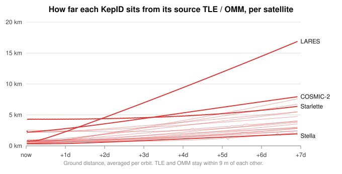
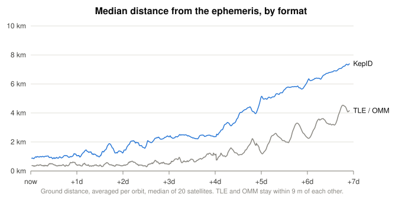

# KepID profile 0: deviation comparison

This document compares KepID with TLE and OMM against independent ephemerides of 20 low Earth orbit satellites, over one week. It describes the data, the method, the results and their limits. It is informative. The format is defined in [the spec](spec.md), and the catalog-wide accuracy figures are in [the rationale](rationale.md), section 8.

## 1. Question

A KepID is lossy, and it is usually judged against the element set it came from. That comparison leaves out the fact that the element set is itself an approximation. This study places all of them against a common reference, to answer two questions:

1. How does the distance between a KepID and its source element set change over a week?
2. How does that distance compare with the distance between the source element set and the satellite's ephemeris?

## 2. Summary

The element sets here have their epochs at the ascending node, as most published element sets do.

- **TLE and OMM agree closely.** A TLE written from a full-precision OMM stayed within 9 m of it.
- **KepID's distance from its source grows steadily.** The median was 0.97 km after one day and 3.88 km after 166 hours. A straight line fits each satellite's week to within 0.25 km RMS, and the growth rate follows largely from the rounding of the mean motion.
- **TLE and OMM also leave the ephemeris.** Their median distance from it went from 0.41 km after one day to 4.16 km after 166 hours, by then about the same as the KepID's distance from its source.
- **KepID remains further from the ephemeris** throughout the week, at a median of about 2.5 times the TLE and OMM distance after one day and about 1.8 times after 166 hours.
- **The epoch matters.** With epochs away from the node, KepID's median distance from its source after one day is 1.82 km, nearly twice as much (section 6).

## 3. Data

An ephemeris here means a time series of satellite positions from a source other than SGP4. All sources are public and need no login. They were surveyed on 2026-11-03.

| Source | Satellites | Kind | Period used |
|---|---:|---|---|
| [ILRS predictions](https://ilrs.gsfc.nasa.gov/data_and_products/predictions/index.html) (CPF, EDC archive) | 5 | forecast | from 2026-11-02 |
| [COSMIC-2](https://data.cosmic.ucar.edu/gnss-ro/cosmic2/) (UCAR) | 4 | near-real-time reconstruction | from 2026-10-23 |
| [Spire](https://data.cosmic.ucar.edu/gnss-ro/spire/) (UCAR) | 5 | near-real-time reconstruction | from 2026-10-23 and 2026-10-26 |
| [PlanetIQ](https://data.cosmic.ucar.edu/gnss-ro/planetiq/) (UCAR) | 1 | near-real-time reconstruction | from 2026-10-23 |
| [Swarm](https://swarm-diss.eo.esa.int/) (ESA) | 3 | reconstruction | from 2026-10-21 |
| [Sentinel-1](https://step.esa.int/auxdata/orbits/Sentinel-1/POEORB/) (ESA) | 2 | precise reconstruction | from 2026-06-18 and 2026-06-23 |

A satellite qualifies if it has seven days of data with no gap above 3 hours. Earth orientation comes from the [IERS finals2000A series](https://datacenter.iers.org/data/9/finals2000A.all).

Sources considered and not used:

- **Starlink** ephemerides cover 72 hours.
- **JPL Horizons** describes its ISS trajectory as TLE-based, so it is not independent.
- **Other Spire satellites** (16) have longer gaps.
- **PlanetIQ 008** had no clean week once bad data was removed.

The sample is not the catalog. It has 13 satellites with a perigee of 400–600 km and none from the large constellations, and it has more satellites at low and near-polar inclinations than the catalog has.

## 4. Method

**Time.** Each satellite has a fixed "now": the first time on a 4 minute grid that starts a week of usable data. Later times are measured from it, so the time axis is shared even though the dates differ.

**Reference positions.** Sources are converted to Earth-fixed positions in UTC, removing the 18 s between GPS time and UTC where it applies. Positions are interpolated onto the 4 minute grid with a 10-point Lagrange polynomial, never across a span above 40 minutes, then converted to TEME using polar motion, UT1−UTC and GMST.

**Bad data.** The near-real-time products contain bad points, some thousands of kilometres off. On all sources, a row is dropped if its neighbours predict it no better than 200 m. On those products only, a row is also dropped if it is over 25 km from the median distance from Earth's centre over about two orbits, or if it steps over 1.5 km above the median fit residual over 6 hours. Rejection removed 11 to 288 rows on 8 satellites, out of about 14,000 each.

**Maneuvers.** Orbit size was checked from orbit to orbit. Sentinel-1C shows a change of about 2 km on 2026-06-23, so its week starts after that. No other sudden change was found, which does not exclude small maneuvers.

**OMM.** SGP4 elements, including B*, are fitted to the reference positions of the first 48 hours by least squares on position, using WGS72. The fit starts from the first state and runs in stages of 6, 12, 24 and 48 hours, using equinoctial elements so that it stays stable near zero eccentricity. The fits land 0.30–0.66 km RMS from their data.

No public OMM with more digits than a TLE was found, which is why the OMMs are fitted. Fitted values keep full double precision.

**Epoch.** The epoch is the first time after now when the fitted mean argument of latitude λ reaches 0.11°, the median among published element sets within 2° past the node, which are 90 % of the LEO catalog. It falls at most 92 minutes after now. The elements are refitted at that epoch.

**TLE and KepID.** Both are produced from the fitted OMM with the KepID library, then read back and propagated with the same SGP4.

**Distance.** At each grid point, the compared position is projected radially onto the WGS84 ellipsoid under the reference position. The result is split into along and across the reference orbit plane, and the ground distance combines the two. Radial differences are not included, so this measure is smaller than a 3D distance.

**Averaging.** A distance oscillates over each orbit, so each satellite's series is averaged over one orbital period centred on each sample. An average needs 75 % of its window. Short holes in the averaged series are filled linearly, at most 234 of about 2,500 steps. Each chart and table reports statistics across the satellites at each time step. The last step is +166 hours, as later windows would run out of data.

## 5. Results

Ground distance across the 20 satellites, averaged per orbit (km):

| Time | Ephemeris to TLE / OMM, median | Ephemeris to KepID, median | TLE / OMM to KepID, median | TLE / OMM to KepID, p25–p75 | TLE / OMM to KepID, min–max |
|---|--:|--:|--:|--:|--:|
| +2 h | 0.33 | 0.90 | 0.75 | 0.60–1.31 | 0.34–4.32 |
| +24 h | 0.41 | 1.05 | 0.97 | 0.68–2.29 | 0.38–4.30 |
| +72 h | 0.46 | 2.35 | 1.86 | 1.23–2.96 | 0.75–6.97 |
| +120 h | 1.25 | 5.12 | 2.82 | 1.91–4.50 | 1.18–11.92 |
| +166 h | 4.16 | 7.40 | 3.88 | 2.83–5.72 | 1.93–16.88 |

### Distance from the source element set

All 20 lines rise and are close to straight. A straight line fits the week with a median error of 0.11 km RMS, and within 0.25 km for every satellite. Slopes range from +0.18 to +2.42 km per day, with a mean of 0.56.

A mean motion error Δn moves a satellite along its orbit at a constant rate, about 2π × 6,371 km × Δn per day when Δn is in rev/day. Across the 20 satellites, that predicted rate correlates at 0.92 with the rate measured from +4 days onward. LARES is the clearest case, at 2.17 km per day predicted and 2.56 measured. The prediction is weaker when Δn is small: Spire (259) is predicted near 0 and measured at 0.44 km per day, so other rounded fields also contribute.

The starting distance also varies. Most satellites start under 1 km. COSMIC-2, at 24°, starts at 2.3–2.8 km after one day, as inclination codes are coarse where few satellites are. Starlette starts at 4.3 km, with an eccentricity of 0.02 and larger rounding of its inclination and eccentricity than the others.

### Distance from the ephemeris

Neither format stays on the ephemeris. For about the first three days the TLE and OMM stay near 0.5 km, partly because the fit covers the first 48 hours, and then grow as drag and SGP4's model limits accumulate.

KepID stays above them for the whole week, at about 0.6 km more after one day. In the first days its distance from the ephemeris is close to its distance from its source, as rounding dominates. By the last day the two errors are of similar size at the median, and from about +138 hours the TLE and OMM median is at times the larger.

Means are higher than medians late in the week, because a few satellites drift far from their fit. Swarm A and C reach 45.77 and 40.50 km from the ephemeris at +166 hours, against a median of 4.16 km; the mean is 8.95 km. Their perigee near 410 km suggests drag, which was not verified.

### Per satellite

Distances in km, rates in km per day. "Predicted" is the along-orbit rate from the mean motion rounding, and "measured" is the rate of TLE / OMM to KepID from +4 days onward, both as absolute values.

| Satellite | Perigee (km) | i (°) | Ephemeris kind | Now | TLE / OMM to KepID, +24 h | TLE / OMM to KepID, +166 h | Predicted rate | Measured rate | Ephemeris to TLE / OMM, +166 h |
|---|--:|--:|---|---|--:|--:|--:|--:|--:|
| Swarm A | 410 | 87.3 | reconstruction | 2026-10-21 | 0.58 | 3.55 | 0.38 | 0.58 | 45.77 |
| Swarm C | 410 | 87.3 | reconstruction | 2026-10-21 | 0.59 | 2.82 | 0.34 | 0.45 | 40.50 |
| Swarm B | 476 | 87.7 | reconstruction | 2026-10-21 | 0.86 | 2.43 | 0.12 | 0.36 | 17.01 |
| Spire (197) | 522 | 97.7 | near-real-time | 2026-10-23 | 0.67 | 4.05 | 0.49 | 0.63 | 10.51 |
| Spire (225) | 547 | 97.7 | near-real-time | 2026-10-23 | 0.95 | 2.92 | 0.52 | 0.31 | 3.35 |
| Spire (259) | 554 | 97.5 | near-real-time | 2026-10-23 | 0.69 | 2.17 | 0.00 | 0.44 | 1.32 |
| PlanetIQ (005) | 555 | 97.7 | near-real-time | 2026-10-23 | 0.63 | 2.83 | 0.19 | 0.50 | 3.88 |
| Spire (233) | 567 | 97.7 | near-real-time | 2026-10-26 | 0.84 | 2.43 | 0.30 | 0.31 | 4.45 |
| COSMIC-2 (006) | 575 | 24.0 | near-real-time | 2026-10-23 | 2.32 | 4.75 | 0.06 | 0.47 | 6.38 |
| COSMIC-2 (001) | 576 | 24.0 | near-real-time | 2026-10-23 | 2.35 | 5.50 | 0.17 | 0.58 | 11.97 |
| COSMIC-2 (002) | 576 | 24.0 | near-real-time | 2026-10-23 | 2.78 | 7.94 | 0.48 | 0.90 | 6.22 |
| COSMIC-2 (005) | 576 | 24.0 | near-real-time | 2026-10-23 | 2.40 | 3.82 | 0.31 | 0.46 | 1.66 |
| Spire (209) | 593 | 97.8 | near-real-time | 2026-10-23 | 0.99 | 3.93 | 0.66 | 0.46 | 5.40 |
| Larets | 673 | 98.4 | forecast | 2026-11-02 | 1.02 | 6.75 | 0.93 | 1.00 | 0.49 |
| Sentinel-1A | 695 | 98.2 | reconstruction | 2026-06-18 | 1.00 | 7.60 | 0.91 | 1.20 | 8.86 |
| Sentinel-1C | 695 | 98.2 | reconstruction | 2026-06-23 | 1.23 | 5.48 | 0.71 | 0.76 | 3.56 |
| Stella | 796 | 98.8 | forecast | 2026-11-02 | 0.38 | 1.93 | 0.28 | 0.28 | 3.80 |
| Starlette | 805 | 49.8 | forecast | 2026-11-02 | 4.30 | 6.38 | 0.43 | 0.53 | 1.15 |
| LARES | 1435 | 69.5 | forecast | 2026-11-02 | 2.28 | 16.88 | 2.17 | 2.56 | 0.71 |
| Ajisai | 1479 | 50.0 | forecast | 2026-11-02 | 0.95 | 2.99 | 0.56 | 0.44 | 1.98 |

## 6. The position of the epoch

Published element sets cluster just past the ascending node (rationale, section 7), and the λ curve puts its finest codes there. A KepID's rounding therefore depends on where along the orbit its element set is written, not only on the orbit. The study was run twice to measure this, with the same fits apart from the epoch: once at the node, and once with an epoch 123,456 µs after now, which is an arbitrary point on the orbit. The TLE and OMM distances from the ephemeris do not change, as both element sets describe the same motion.

| Time | TLE / OMM to KepID, median, epoch at the node (km) | TLE / OMM to KepID, median, arbitrary epoch (km) |
|---|--:|--:|
| +2 h | 0.75 | 1.65 |
| +24 h | 0.97 | 1.82 |
| +72 h | 1.86 | 2.52 |
| +120 h | 2.82 | 3.62 |
| +166 h | 3.88 | 4.53 |

The same effect shows on the rationale's own catalog, using its measure (3D distance between the original and decoded element sets, after 24 hours) for a perigee of 400–600 km, with the mean anomaly moved by 90° and every other element unchanged:

| Catalog, perigee 400–600 km | Element sets | Median after 24 h (km) |
|---|--:|--:|
| As published | 11,751 | 0.56 |
| λ within 2° past the node | 10,597 | 0.53 |
| λ elsewhere, as published | 1,154 | 1.06 |
| Moved 90° from the node | 11,751 | 1.84 |

**Comparison with the rationale.** For that perigee range, the rationale reports a median of 0.57 km after 24 hours. Across the 13 satellites here it is 0.86 km with epochs at the node, and 1.75 km with arbitrary epochs. The remaining difference follows the inclination: the 9 satellites other than COSMIC-2 have a median of 0.69 km, and the 4 COSMIC-2 satellites, at 24°, have 2.38 km. In the catalog, as published, the median by inclination is 0.47 km above 92°, 0.56 km from 30° to 56°, 0.95 km from 56° to 92° and 1.61 km below 30°.

The two measures also differ. This study reports a ground distance averaged over an orbit, and the rationale a 3D distance at one instant, so the figures are close but not directly equal. With only 13 satellites, they should be read as consistent, not as an independent measurement of the catalog's median.

## 7. Limits

- **The fit favours TLE and OMM early on.** The OMMs are fitted to the first 48 hours of the same ephemeris they are compared with. Unfitted CelesTrak OMMs, compared with the ILRS predictions over two days, were 0.3–0.8 km RMS away, close to the fits' own 0.30–0.66 km, but a published element set is usually hours or days old already.
- **The fit looks only forward.** An element set in operation is fitted to data before its epoch. Here it is fitted to the 48 hours from its epoch onward.
- **The sample is small and selected.** There are 20 satellites, chosen by data availability. Five of them are passive geodetic spheres, and none is from a large constellation.
- **The references differ.** Five are forecasts, 10 are near-real-time reconstructions and 5 are reconstructions. Near-real-time products were not checked against precise orbits, and forecasts are not measured tracks.
- **The dates differ.** Periods run from June to November 2026, under different solar conditions.
- **Maneuvers.** Small maneuvers may remain in the data.
- **Averaged distances.** Instantaneous distances are larger at some points of the orbit than the averages shown here.
- **One encoder.** All figures use profile 0 as implemented by the KepID library.

## 8. Conclusion

**How does the distance between a KepID and its source element set change over a week?** It grows steadily. With epochs at the ascending node, the median goes from 0.97 km after one day to 3.88 km after 166 hours. Each satellite follows a nearly straight line, within 0.25 km RMS, at its own rate of 0.18 to 2.42 km per day. The rate follows largely from the rounding of the mean motion, which is limited by the width of its codes. The distance varies between satellites: the highest value at 166 hours is 16.88 km, for LARES. The position of the epoch also matters, as an arbitrary epoch nearly doubles the median after one day.

**How does that distance compare with the distance between the source element set and the satellite's ephemeris?** It is larger at first, and about equal by the end of the week. The median distance from the ephemeris to the TLE or OMM is 0.41 km after one day, against 0.97 km from the TLE or OMM to the KepID. At 166 hours they are 4.16 km and 3.88 km. Neither TLE nor OMM stays on the ephemeris, and they differ from each other by only 9 m, so their digits are not the limit. A KepID's own distance from the ephemeris stays above theirs throughout, by a median factor of about 2.5 after one day and 1.8 after 166 hours.

Within the limits of section 7, a KepID adds a growing and largely predictable error to an element set whose own error also grows. In the first days KepID's rounding is the larger of the two. By the end of a week the two are of the same size.
