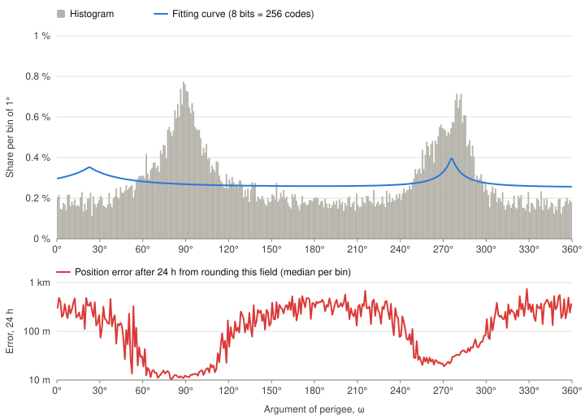
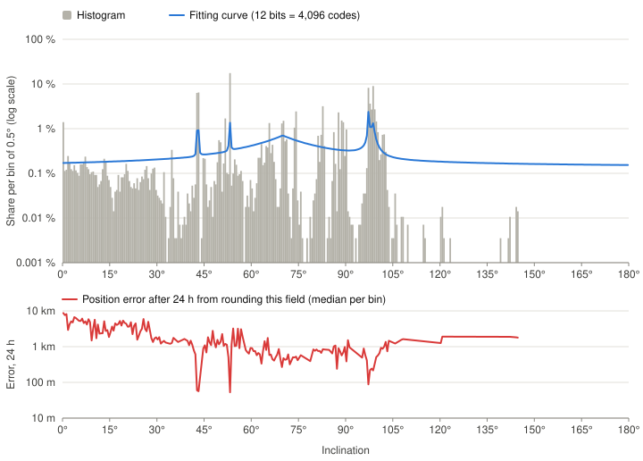
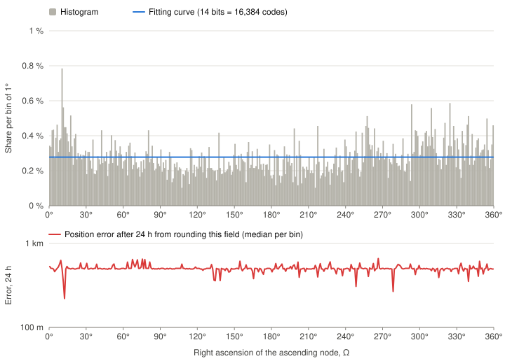
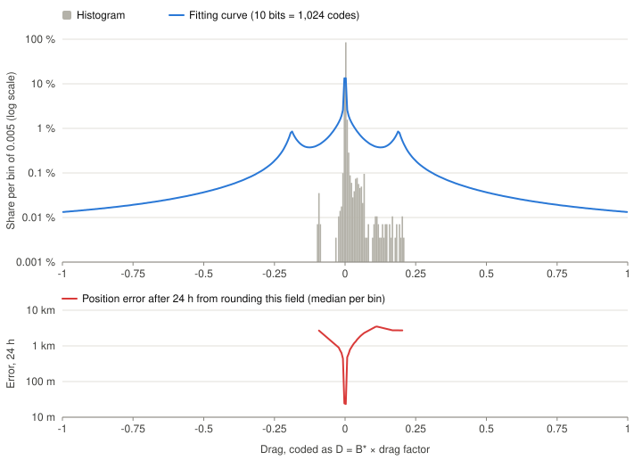
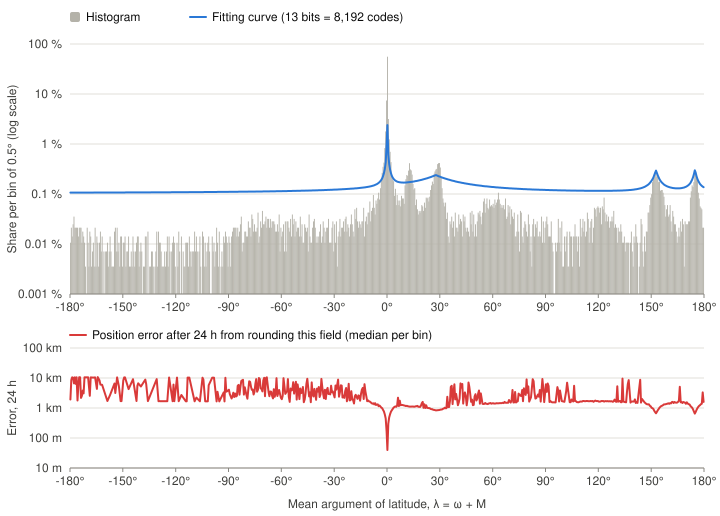
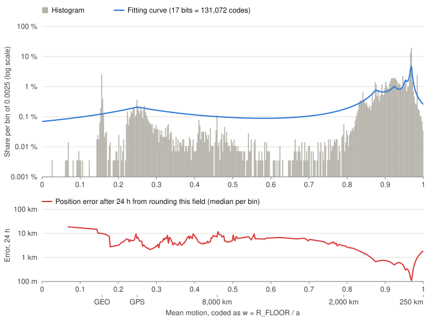
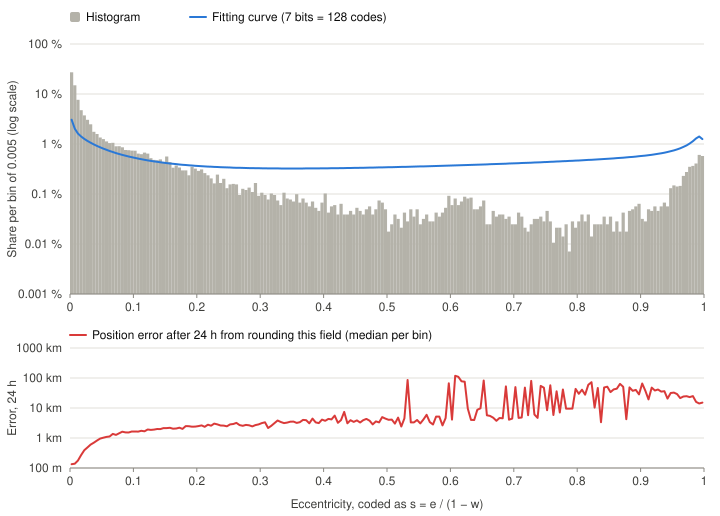

# KepID profile 0: rationale

This document explains what KepID is for and why profile 0 looks the way it does: what the codes are spent on, how it compares with the closest prior art, what the limits exclude, the data the curves were fitted to, how they were fitted, why each field has its width, and how precise the result is. It is informative. The format itself, with every rule and constant, is defined in [the spec](spec.md), and where the two differ, the spec wins.

All figures come from the catalog described in section 5, a snapshot of late October 2026.

## 1. What KepID is for

A KepID trades precision for size and convenience. It fits where many orbits have to be stored, sent or indexed, and where a few hundred metres to a few kilometres of extra error don't matter. Three properties make this work: a KepID is small, it carries its own time, and it is a UUID.

- **A lot in space: bulk transfer and display.** A catalog of 30,000 orbits takes about 0.5 MB as KepIDs, against about 4 MB as TLEs and over 12 MB as OMM in JSON. A globe or dashboard showing every satellite doesn't need better than kilometres, and while it animates, the satellites move faster than that error is visible. The propagation work stays the same; storage and transfer shrink.
- **A lot in time: archives.** Missions often keep the element set behind each computation: a pass plan, an observation, a manoeuvre decision. As text that's 140 bytes per TLE, or several hundred per OMM. As a KepID it's 16 bytes in a native UUID column.
- **Plays well with databases.** With the epoch in the top bits, a time range is a key range. A compound index on (object, KepID) holds an object's entire orbit history inside the index, so "where was this object around this time" can be answered by an index-only scan, without touching the table.
- **Cache and deduplication keys.** The same element set always gives the same KepID, so results computed from an orbit (passes, ground tracks, visibility windows) can be cached under it. Copies of one element set from different sources collapse to one key, and here the collisions by design help.
- **Traceability.** A single field in a log, a message or an event records which orbit a computation used, and any UUID tool can read its epoch.
- **Links and small channels.** The 36-character text form fits a URL, a QR code or a short message. The 16 binary bytes fit radio and IoT payloads where a 140-byte TLE doesn't.

**What it is not for:** precise work, such as conjunction assessment, orbit determination or manoeuvre planning, which needs the full element set; and identifying objects, which is what catalog numbers do.

## 2. Design priorities

The codes are spent where element sets are, in this order:
1. low Earth orbit, and the 400–600 km shell most of all;
2. the inclinations and orbit shapes that are common there;
3. everything else, which is covered everywhere but more coarsely.

So the resolution follows the population of element sets. An orbit far from today's common values, such as an uncommon inclination or a high orbit, still encodes, with a coarser step.

## 3. Prior art

### Galileo Reduced CED

The closest relative of KepID in spirit that we found is the **Reduced Clock and Ephemeris Data** (Reduced CED) of the Galileo I/NAV message [GALILEO-ICD] (section 5.1.11). It packs a satellite's orbit and clock correction into one **122-bit** word, so a receiver can compute a first position before the full ephemeris (four words) arrives.

| | Galileo Reduced CED | KepID, profile 0 |
|---|---|---|
| Purpose | broadcast message for a fast first fix | stored identifier for an orbit |
| Orbits covered | Galileo satellites only, around a known nominal orbit (A = 29,600 km, i = 56°) | every closed Earth orbit above the 250 km perigee floor |
| Model | GNSS broadcast ephemeris, correction terms set to 0 | SGP4 mean elements, with drag |
| Validity | 10 minutes from its reference time | the propagation horizon of the source element set: days to weeks |
| Time | none in the word: a time of week, taken from when the word was received, that repeats every week | absolute: 40 bits of 256 ms ticks since 1970, never repeating before about the year 10,900 |
| Orbit bits | 94: ΔA 5, eₓ 13, e_y 13, Δi 17, Ω 23, λ 23 | 81: w 17, s 7, ω 8, i 12, Ω 14, λ 13, D 10 |
| Other bits | 28 of clock correction | 40 of epoch, 7 of UUID and profile markers |
| Quantization | uniform fixed point | data-fitted curves ([the spec](spec.md), section 5) |
| Range of each field | narrow offsets: ΔA within ±4 km, \|eₓ\|, \|e_y\| < 0.001, Δi within ±2.8° | full ranges: e up to 1, i from 0 to 180°, any orbit size |
| Output format | raw bits in I/NAV word type 16 (a 6-bit type field plus the 122 bits), read only by receivers | a UUIDv7: 128 bits with a standard text form, 32 hex digits grouped 8-4-4-4-12 |
| Ordering | none | text and binary order follow the epoch |

**What they share.** Both use the mean argument of latitude λ = ω + M instead of the mean anomaly. Both code a size relative to a reference: Reduced CED as an offset from the nominal semi-major axis, KepID as w = R_FLOOR / a. Both show that the elements fit in about 120 bits once the precision is chosen for the job.

**Where they differ.** Reduced CED knows in advance which orbit it describes, so it spends almost no bits on range and nearly all of them on precision: an angle step of 2⁻²² semicircles, about 0.00004°, needed for metre-level ranging over 10 minutes. KepID describes any orbit, so it spends its bits on covering every possible range. The curves then concentrate the precision where element sets actually are.

**Time.** Reduced CED is transient. The word carries no time of its own: its reference time comes from the moment the receiver hears it, as a time of week that wraps every 604,800 seconds, and the data expires 10 minutes later. Once the next word arrives the old one has no use. A KepID is historical. It carries an absolute epoch, so a KepID stored today still says when its orbit applied, to within 128 ms of the original epoch, years later. This costs 40 bits, which Reduced CED never has to spend.

**Format.** Reduced CED is a field layout inside a navigation message: raw bits, defined only by the ICD and never exchanged as text. KepID chose a general-purpose envelope instead. A KepID is a valid UUIDv7 [RFC9562], so it brings the UUID ecosystem with it, with no new tooling:
- **Storage and exchange:** it goes wherever a UUID goes: native 16-byte UUID columns, schemas, APIs, JSON, CSV and logs.
- **Parsing:** every mainstream language already parses, validates and formats it. The text form is fixed-length, case-insensitive and URL-safe.
- **Ordering:** the epoch is in the most significant bits, so numeric and text order follow it, and a time range is a key range. When KepIDs are written roughly in epoch order, inserts land at the end of B-tree indexes; loading historical element sets scatters them, as with any key. Among KepIDs with the same epoch tick, the order carries no meaning.
- **Time for free:** any tool that reads a UUIDv7 timestamp gets the epoch (not a creation time), to within 256 ms.
- **Coexistence:** it can share columns and APIs with ordinary UUIDs. The limits that come with this are in the introduction of [the spec](spec.md).

The envelope costs 7 bits (version, variant and the profile bit) and puts the epoch at 256 ms resolution in the timestamp field. In exchange, a KepID is something any software can already store, sort and pass around.

**The lesson.** Reduced CED gets its precision from a narrow, known orbit family and a short life. A KepID has to cover the whole catalog, outlive its moment, and fit a standard envelope. The 40-bit epoch and the non-uniform curves are the price of those three.
### Other ideas KepID builds on

- **TLE and OMM** [SPACETRACK3] [CCSDS-ODM]: the thing being represented. KepID carries the SGP4 mean elements these formats publish, and drops what identifies an object.
- **Geohash, S2, H3 and A5** [GEOHASH] [S2] [H3] [A5]: quantizing geographic data into a compact, sortable key, where one cell stands for a region and the precision is traded for size. A KepID does the same for an orbit.
- **μ-law companding** [G711] **and lossy compression in general**: quantizing through a curve, so that codes are dense where the values are and sparse elsewhere. The classic result that the best code density follows the cube root of the weighted data density [BENNETT] shaped the fitted curves.
- **UPID and Datadog trace IDs** [UPID] [DATADOG]: structured content inside a 128-bit, UUID-sized envelope. UPID puts a type prefix and a timestamp into a UUID slot; Datadog's 128-bit trace IDs put a timestamp in the top bits.
- **Snowflake IDs and their variants** [SNOWFLAKE]: a fixed map of bits holding several fields (a timestamp, a worker, a sequence), with the time in the most significant bits so the IDs sort by it. A KepID's map holds orbital elements instead.

## 4. What the limits exclude

Every closed orbit can be encoded, from LEO out past the Moon's distance, except those below the perigee floor and those before 1970 ([the spec](spec.md), section 1).

**What the perigee floor excludes.** Not only objects about to re-enter, but also elliptical orbits whose perigee dips below 250 km while the rest of the orbit is far higher, such as transfer-orbit stages, which can stay in orbit for years. In a 2026 catalog of 28,443 element sets the floor excludes 150: 17 low orbits that are decaying, 65 elliptical orbits with an apogee between 2,000 and 20,000 km, and 68 with an apogee above 20,000 km.

**The floor is nominal.** Here a is the two-body semi-major axis that goes with n, from `MU` and `RE` (WGS-84 values; [the spec](spec.md), section 7, step 1). SGP4 works out its own semi-major axis differently, with WGS-72 constants and a correction to n, and its perigee differs from this one by a few kilometres. The floor is a rule of the encoding, not a statement about where SGP4 puts the satellite. SGP4's own WGS-72 values appear only in the drag factor (section 7, D), which mirrors SGP4's drag term.

**No epochs before 1970.** A UUIDv7 timestamp cannot be negative, so element sets from 1957 to 1969 cannot be encoded, even though the TLE year rule ([the spec](spec.md), section 7) reads their years.

## 5. The data behind the curves

The element sets are a sample of the public data published by CelesTrak (celestrak.org), not a complete copy of any catalog.

The curves were fitted to real data: **28,443 element sets**, one per tracked object, downloaded in late October 2026 (most epochs fall between 24 and 27 October 2026). The set was built to cover the whole population, not just the satellites people usually think of:

- **15,903 active satellites** from **99 owner countries and organisations**: large constellations, Earth-observation and science missions, crewed stations, navigation, communication and weather satellites.
- **2,158 rocket bodies** and **10,127 pieces of debris**, including the debris clouds of the best-known breakups: the 2009 Iridium–Cosmos collision and the Fengyun-1C and Cosmos 1408 anti-satellite tests.
- **215 objects** that are tracked but not yet publicly identified.
- **870 objects in higher orbits, added on purpose** so these orbits are not drowned out by the numbers in low orbit:
  - navigation constellations;
  - the geostationary belt and the graveyard orbits beyond it;
  - 12-hour highly elliptical orbits;
  - geodetic satellites;
  - objects farther out than geostationary orbit.

All but 150 of these element sets are valid KepID input. Of those, 12,267 sit in the busy 400–600 km shell, 12,914 elsewhere in low Earth orbit, and about 3,100 above it.

**Why one snapshot is enough.** A snapshot is a picture of one moment, and the population changes: satellites decay and re-enter, and new ones are launched. But it changes slowly compared with the life of a format, and in a predictable way. New satellites mostly go where satellites already are: the same altitude shells, the same sun-synchronous and constellation inclinations, the same geostationary belt. Those are the places this data gives the most codes to. A curve has to be fitted to some population, and a recent, complete catalog is the most honest starting point. The curves also keep a minimum density everywhere, so orbits that are rare today still encode, only with coarser steps. If the population ever moves far from this snapshot, the profile bit leaves room to define a new profile whose curves are fitted to newer data.

**Checked on unseen data.** To test whether the curves depend on these particular element sets, the catalog was split into two halves by catalog number, odd and even. The curves were fitted on each half alone, with the same method and field widths, and scored on the half they had not seen. Median position error, km, averaged over both halves:

| Orbit class | Fitted on everything, 24 h | Unseen half, 24 h | Fitted on everything, 1 week | Unseen half, 1 week |
|---|---|---|---|---|
| LEO, 400–600 km | 0.57 | 0.58 | 1.98 | 1.93 |
| LEO, other altitudes | 1.72 | 1.79 | 5.04 | 5.09 |
| above LEO | 35 | 37 | 76 | 94 |

- **LEO:** the curves don't depend on which element sets they were fitted on. On the unseen half the errors match the official curves within about 4 %.
- **No overfitting:** every fit scores the same on the half it saw and on the half it did not.
- **Above LEO:** each half holds only about 1,500 element sets, and the half-catalog fits are about 25 % worse after one week, on both halves. Fitting on the whole catalog matters there, and more high-orbit data would help a future profile.

**Checked on satellites launched later.** A sharper test of a snapshot is time. The curves were also fitted only on objects launched before 2024, and scored on the 9,955 element sets launched in 2024 or later: a third of the catalog, most of it in new constellation shells. Median / 95th percentile position error, km:

| Orbit class | Official curves, 24 h | Fitted before 2024, 24 h | Official curves, 1 week | Fitted before 2024, 1 week |
|---|---|---|---|---|
| LEO, 400–600 km | 0.53 / 1.3 | 0.56 / 1.4 | 2.05 / 6.3 | 2.48 / 6.9 |
| LEO, other altitudes | 1.30 / 3.4 | 1.38 / 3.2 | 5.40 / 39.7 | 5.66 / 29.2 |

- **After 24 hours,** satellites the curves never saw cost about 6 % more.
- **After a week,** the median in the busy shell is about 20 % worse; the 95th percentiles barely move.
- **Above LEO,** only 120 such element sets exist, too few to judge.

So curves fitted on an older population still serve a new one, at a modest cost that a later profile, fitted on newer data, would recover.

## 6. How the curves were fitted

For every element set and every field, SGP4 measured how far a small change in that field moves the satellite at the epoch, after 24 hours and after one week. A curve's cost is the position error its rounding causes, summed over all element sets:

- **Horizons:** the epoch and 24 hours count fully; one week counts a quarter.
- **Priorities:** the 400–600 km shell counts 4 times as much as the rest of LEO, and active satellites 1.5 times as much as other objects. Orbits above LEO count 0.1 × (7,000 km / a)², so their far larger distances don't drown out low orbits. Element sets below the perigee floor are left out.
- **Error measure:** the cost is the average error in kilometres, not the squared error, so a few extreme orbits can't dictate the curve. It is reached in three rounds of reweighting.
- **Floors:** every curve keeps at least a fixed share of uniform code density everywhere (section 8). The mean-motion curve must also keep the worst-case along-track drift under 400 km in a week, from 2,000 km out past the geostationary graveyard.

For each field, curves of 0 to 6 layers ([the spec](spec.md), section 5) were fitted, and the simplest one within 2 % of the lowest cost was kept. Layers with a share of 0 were dropped, and the parameters were rounded to 10 significant digits, which changes no KepID in the catalog.

### Field widths

**The field widths are a separate choice.** Complete layouts with different widths were compared by propagating the whole catalog and measuring the position error after 24 hours and after one week, under the same priorities. The widths in [the spec](spec.md), section 3, are the best of the layouts compared. They are inputs to the curve fit, not outputs of it.

**Why each field has the width it has.** The 81 bits left after the epoch, the version and variant bits and the profile bit are shared among seven fields, so every bit given to one field is taken from another. The principle is simple: **a field gets more bits the more its values vary across real element sets, and the more a rounding error in it moves the satellite.** A field whose values all sit in a narrow band, or whose error barely changes the position, needs few codes. A field spread over a wide range, where a small error costs kilometres, needs many. Complete layouts were compared by simulation (above), and the widths that did best among them follow this principle field by field:

- **w, mean motion, 17 bits, the widest.** Its values range from LEO to beyond geostationary orbit, and its impact grows with time: an error in mean motion makes the satellite drift along its track, further every hour. After a week it is the largest source of error, so it gets the most bits.
- **Ω, right ascension of the ascending node, 14 bits.** Its values are spread evenly over the full 360°, with no clusters a curve could exploit, so it needs fine steps everywhere. Its error tilts the orbit plane and moves the satellite across its track.
- **λ, mean argument of latitude, 13 bits.** It places the satellite along its orbit at the epoch, so its error is a position error from the first second. Its values are spread over 360°, but most epochs sit just past the ascending node, which lets the curve give that region fine steps with fewer bits than Ω.
- **i, inclination, 12 bits.** Its error, like Ω's, tilts the orbit plane. Its values cluster tightly at a few inclinations, such as the large constellations and sun-synchronous orbits, so a curve can concentrate the codes there.
- **D, drag, 10 bits.** Drag shapes the orbit slowly, and its effect is small next to the other fields. Its values are concentrated near zero, so a narrow range needs fine coding and the rest can be coarse.
- **ω, argument of perigee, 8 bits.** Its error moves the satellite only in proportion to the eccentricity, and most orbits are nearly circular, so its impact is usually small even where its values are spread.
- **s, eccentricity, 7 bits, the narrowest.** Most values are close to zero, and for near-circular orbits a small error in s costs little. The few highly eccentric orbits pay for this with coarser steps (section 8).

The closest alternative layout moved one bit between s and ω. It did worse after one week.

## 7. The curves, field by field

Each chart below has two panels with the same horizontal axis, the value as the field codes it:
- **Top:** the *histogram* is the share of the element sets of section 5 in each bin. The *fitting curve* is the share of the field's codes that falls in the same bin.
- **Bottom:** the median position error after 24 hours, in SGP4, caused by rounding that field alone. A KepID rounds every field at once, so its total error is larger (section 8).

The curves do not follow the histograms one to one. They give codes where rounding costs the most kilometres, weighted by the priorities of section 2, and every curve keeps a minimum density everywhere.

### ω, argument of perigee

The values have two broad peaks, near 90° and near 270°. The first is mostly near-circular orbits kept at a frozen ω; the second is mostly highly elliptical orbits held near 270°, together with their launch stages. Elsewhere they are nearly flat.

Rounding ω moves the satellite in proportion to e × a, so near-circular orbits barely feel it: the 90° peak gets no extra codes and still rounds to 10–20 m. The curve is close to uniform. It adds codes near 276°, where eccentric orbits make ω costly, and a broad, weak bump near 22°, where transfer-orbit upper stages and other eccentric objects add weight. Errors are tens to hundreds of metres.

### i, inclination

The values cluster sharply at a few inclinations: 43° and 53° (large constellations), 97–98° (sun-synchronous), 51.6°, around 70° and 82–87°, and near 0° (geostationary). Very few orbits are above 105°.

The curve puts narrow spikes at 43°, 53° and 97–98°, a broad bump around 70°, and a floor elsewhere. A rounding error is about 50 m at 43° and 53°, about 200 m at sun-synchronous inclinations and about 1 km elsewhere in LEO. Below 30° it reaches several kilometres, because most orbits there are high and the same angle covers more distance.

The curve follows today's population. 61 % of element sets get an inclination step of 0.02° or finer, and 36 % one of 0.005° or finer; 8.4 % get a step coarser than 0.05°. A future constellation at an inclination that is uncommon today gets the coarse steps for as long as profile 0 is used.

### Ω, right ascension of the ascending node

Earth's oblateness turns every orbit's node around the equator, so the values are spread almost evenly over 360°. The code density that would minimize the position error is flat within noise, so Ω has no curve: its codes are uniform, and its error is a nearly constant 300–500 m.

### D, drag

D is B* scaled by how much drag moves the satellite in SGP4 ([the spec](spec.md), section 6.3), so the same codes serve low and high orbits:
- **D follows the position effect.** D is proportional to the effect drag has on the position, and is 1 for B* = 1 on a circular orbit at 500 km.
- **High orbits.** At high altitude the factor falls by orders of magnitude, so D, and with it the drag resolution, flattens where drag stops mattering.
- **Elliptical orbits** with a low perigee get the factor back through the eccentricity term.

Almost all values are small: 85 % of element sets fall in the bin around 0. Most are positive, and a few are negative, as SGP4 fits allow.

The curve gives most of its codes to small |D|, with the exact zero code at the centre, and still reaches the largest values seen, about 0.2, and the saturation at ±1. A rounding error is tens of metres near zero drag and 1–3 km at high drag.

### λ, mean argument of latitude

Element sets are customarily published with their epoch at the ascending node crossing. 59 % of element sets have λ within 1° past the node and 68 % within 1° either side; smaller clusters sit near 12°, 28°, 152° and 175°.

The curve puts a sharp spike just past the node and smaller peaks near 152° and 175°. Element sets at the node get steps of 0.001° to 0.013°, a rounding error of about 40 m at the node and about 1 km just past it. The rest get steps of about 0.05°: up to about 3 km along-track in LEO from λ alone, and 2–10 km on the far side of the orbit, where few epochs fall. Element sets from producers that put the epoch elsewhere always fall in that coarser group.

### w, mean motion

The axis is w = R_FLOOR / a; the labels under it give the altitude of a circular orbit. Most values are in LEO, between w = 0.8 and 1, with a sharp peak in the 400–600 km shell. Smaller groups sit at the navigation constellations near w = 0.25 and at the geostationary belt near w = 0.16.

The curve is densest in the 400–600 km shell, follows the rest of LEO, and stays smooth across higher orbits. A rounding error is about 100 m in the shell and about 1 km elsewhere in LEO, rising to about 10 km at geostationary altitude.

### s, eccentricity

The axis is s = e / (1 − w); s = 1 means a perigee exactly on the 250 km floor. Most values are near 0, the near-circular orbits, and they fall off steadily. A smaller rise near s = 1 comes from elliptical orbits whose perigee is close to the floor, such as transfer orbits.

The curve is densest near 0, rises again near 1 and keeps a floor between. With only 7 bits, s is the coarsest field. A rounding error is about 100 m for near-circular orbits, 1–10 km in between, and up to tens of kilometres for very eccentric orbits.

## 8. Resolution and accuracy

### Next to TLE and OMM

| | OMM (best case) | TLE | KepID |
|---|---|---|---|
| Size per element set | about 200–400 bytes as compact JSON (206 for the eight fields KepID keeps, 416 with the usual identity and bookkeeping fields) | 140 bytes (two 69-character lines) | 16 bytes, or 36 as text |
| Precision of the elements | as many digits as the producer writes, up to full double precision | fixed decimals: 0.0001° for angles (about 6 m in LEO), 10⁻⁸ rev/day for n, 7 digits for e, 5 for B* | rounded to codes (below) |
| Error against the real satellite | SGP4's own: commonly quoted as about 1 km at the epoch, growing 1–3 km a day in LEO [LEVIT2011], and faster for satellites that manoeuvre often [STARLINK2026] | the same as OMM | the same, plus KepID's rounding |
| Identifies the object | yes: catalog number and designator | yes | no |
| Time range | any (ISO 8601) | 1957–2056 (two-digit year) | 1970 to about the year 10,900 |
| Sorts by epoch | no | no | yes |
| Native database type | text or JSON | text | UUID |

**How much KepID adds.** In the 400–600 km shell, KepID's rounding adds a median of 0.74 km at the epoch, 0.57 km after 24 hours and 2.0 km after a week. At the epoch this is the same order as SGP4's own error. After a day it is a small share of a total of several kilometres, and after a week a few per cent of it. A TLE's own decimal rounding, at about 6 m, is negligible next to both.

### Measured

**Accuracy.** Position difference between SGP4 propagations of the original and the decoded element set, over 28,293 element sets of a 2026 catalog (median / 95th percentile, km):

| Orbit class | Element sets | At epoch | After 24 h | After 1 week |
|---|---|---|---|---|
| LEO, 400–600 km | 12,267 | 0.74 | 0.57 / 1.6 | 2.0 / 8.2 |
| LEO, other altitudes | 12,914 | 1.5 | 1.7 / 6.1 | 5.0 / 18.5 |
| navigation MEO (about 20,000 km) | 122 | 9.6 | 10 / 41 | 39 / 76 |
| geostationary belt | 533 | 18 | 21 / 42 | 58 / 118 |
| 12-hour highly elliptical | 45 | 146 | 143 / 259 | 132 / 280 |
| other orbits above LEO | 2,412 | 61 | 59 / 308 | 88 / 318 |

**Resolution.** Every layer keeps a share of uniform density, so no part of a field's range is coded more coarsely than its worst step. A rounding error is at most half a step.

| Field | Codes | Typical steps | Worst step anywhere | Density floor |
|---|---|---|---|---|
| w (n) | 131,072 | n: 2.0 × 10⁻⁵ rev/day at 500 km, 3.1 × 10⁻⁵ at 550 km, 4.3 × 10⁻⁵ at 800 km, 5.6 × 10⁻⁵ at 400 and 1,200 km, 1.1 × 10⁻⁴ at GPS, 1.5 × 10⁻⁴ at GEO | 4 × 10⁻⁴ rev/day in n (near 4,300 km); 2.8 × 10⁻⁵ in w | 0.05 |
| s (e) | 128 | e: 5.0 × 10⁻⁵ / 1.2 × 10⁻⁴ / 4.3 × 10⁻⁴ for e = 10⁻⁴ / 10⁻³ / 10⁻² at 500 km; 8.0 × 10⁻⁴ for e = 3 × 10⁻⁴ at GEO; 0.0024 for e = 0.74 on a 12-hour orbit | 0.012 in s (near s = 0.35) | 0.05 |
| i | 4,096 | 0.0016° at 43°, 0.018° at 53°, 0.017° at 70°, 0.0076° at 97.5°, 0.040° at 51.6°, 0.037° at 87.9° | 0.080° (up to about 5 km cross-track in LEO) | 0.50 |
| Ω | 16,384 | 0.022° everywhere | 0.022° | 1 |
| ω | 256 | 0.97° near 276°, 1.2° to 1.5° elsewhere | 1.53° | 0.91 |
| λ | 8,192 | 0.0011° within 0.1° of the node, 0.013° within 1°, about 0.05° elsewhere | 0.057° | 0.75 |
| D (B*) | 1,024 | B*: 4.7 % / 3.1 % for 10⁻⁴ / 10⁻³ at 400 km, 13 % / 2.4 % at 550 km, 63 % for 10⁻⁴ at 800 km | 0.037 in D (near \|D\| = 1) | 0.02 |

The density floor is the product of (1 − a) over a field's layers. The worst step comes out finer than uniform step ÷ floor, because the layers' bumps never all reach their minimum at the same place.

## 9. Bit-exactness in practice

The spec makes encoding bit-exact by using only operations that IEEE 754 defines exactly, and by forbidding fused multiply-add and fast-math ([the spec](spec.md), section 2). To check this, two implementations, in Rust and in Python, encoded and decoded the 28,443 element sets of section 5. Every KepID and every decoded value matched bit for bit on:

| Platform | How it ran |
|---|---|
| macOS, ARM64 | natively |
| Linux, ARM64 | natively |
| Linux, x86-64 | translated by Rosetta 2 |
| Linux, x86-64 | emulated by QEMU |

The x86-64 runs executed real x86-64 machine code, but not on x86-64 hardware. That leaves little room for a difference. The arithmetic involved is fully specified by IEEE 754, x86-64 does it in SSE2 with no extended precision, and three separate implementations of it (ARM hardware, Rosetta's translation and QEMU's software emulation) already agree.

## References

- **[A5]** F. Palmer, "A5: a pentagonal discrete global grid system", https://a5geo.org.
- **[BENNETT]** W. R. Bennett, "Spectra of Quantized Signals", Bell System Technical Journal 27, July 1948.
- **[CCSDS-ODM]** "Orbit Data Messages", CCSDS 502.0-B-3, Blue Book, April 2023 (also ISO 26900:2024).
- **[DATADOG]** Datadog, "Trace and Span ID Formats", https://docs.datadoghq.com/tracing/guide/span_and_trace_id_format/.
- **[G711]** "Pulse code modulation (PCM) of voice frequencies", ITU-T Recommendation G.711.
- **[GALILEO-ICD]** "European GNSS (Galileo) Open Service Signal-in-Space Interface Control Document", Issue 2.0, January 2021.
- **[GEOHASH]** G. Niemeyer, Geohash, 2008, http://geohash.org.
- **[LEVIT2011]** C. Levit, W. Marshall, "Improved orbit predictions using two-line elements", Advances in Space Research 47 (7), 2011; arXiv:1002.2277.
- **[H3]** Uber Technologies, "H3: a hexagonal hierarchical geospatial indexing system", https://h3geo.org.
- **[RFC9562]** K. Davis, B. Peabody, P. Leach, "Universally Unique IDentifiers (UUIDs)", RFC 9562, May 2024.
- **[S2]** Google, "S2 Geometry", https://s2geometry.io.
- **[SNOWFLAKE]** Twitter, "Announcing Snowflake", 2010.
- **[SPACETRACK3]** F. R. Hoots, R. L. Roehrich, "Models for Propagation of NORAD Element Sets", Spacetrack Report No. 3, December 1980.
- **[STARLINK2026]** "How long can you trust a Starlink TLE? An empirical comparison of SGP4 and high-fidelity propagation against operator-updated truth across a megaconstellation", arXiv:2605.19850, 2026.
- **[UPID]** C. Arderne, "UPID: Universally Unique Prefixed Lexicographically Sortable Identifier", https://github.com/carderne/upid.
