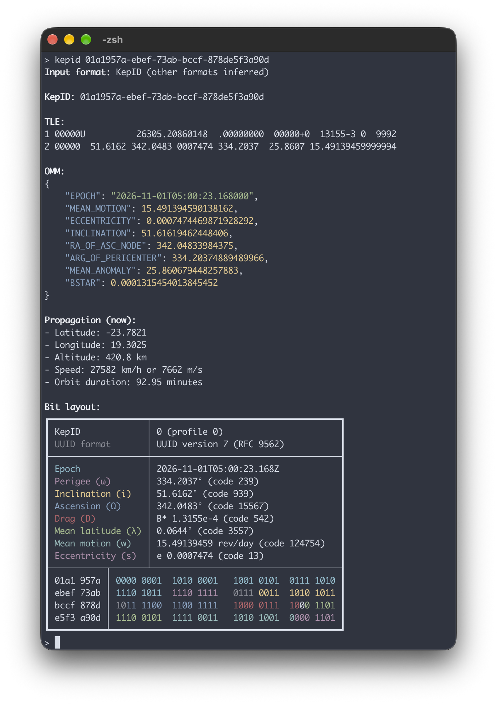

# KepID CLI

Satellite orbits packed into UUIDv7, from the command line. For what KepID is and why, start with the [main README](https://github.com/racum/kepid), and for every rule and constant, the [spec](https://github.com/racum/kepid/blob/main/docs/spec.md). To use it from code, see the [`kepid`](https://crates.io/crates/kepid) library.

## Install

The command-line tool is a separate crate, and installs a binary called `kepid`:

```bash
cargo install kepid-cli
```

## Usage

Give it a KepID and it shows you everything inside:

```bash
kepid 01a1957a-ebef-73ab-bccf-878de5f3a90d
```



On a terminal, each field of the bit layout gets its own color, in both its row and its bits, so you can see exactly where it lives inside the UUID.

Notice that "Propagation (now)" really means now: it runs SGP4 on the KepID's rounded orbit at the current time, so these numbers change on every run. And if the epoch is more than a week old, a warning tells you how old it is, because SGP4 gets less accurate the further it goes from the epoch.

The input doesn't have to be a KepID, and it doesn't have to be a parameter:

- **Formats:** the input can be a KepID, a TLE (with or without the name line) or an OMM in JSON; the format is detected automatically. The format you give is shown as it came, and the other ones are inferred from the KepID.
- **`-i`, `--input <file>`:** reads the input from a file.
- **`-`:** reads the input from standard input, so it fits in a pipe.
- **`-o`, `--output <format>`:** prints just one thing, ready for scripts: `kepid`, `tle` or `omm` for that format alone (converted through the KepID, so rounded), or `json` for the whole analysis as JSON, without the bit layout.
- **`-h`, `--help`** and **`-v`, `--version`:** the usual.

**Important:** when something is wrong with the input, you get only a "Checks" section with the errors (or a `checks` key with `-o json`), and the exit code is 1; otherwise, it's 0. Warnings, like the old epoch, don't count as errors.

Pro tip: colors turn off by themselves when the output is piped. Set `NO_COLOR` to always turn them off, or `FORCE_COLOR` to keep them, for example, when piping into `less -R`.

## License

[MIT](https://github.com/racum/kepid/blob/main/LICENSE).
